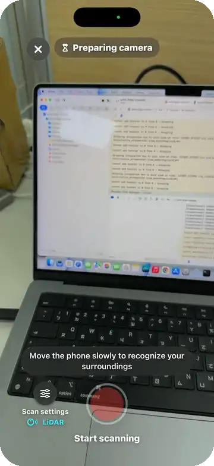

<picture>
  <source media="(prefers-color-scheme: dark)" srcset="./assets/banner-dark.svg" />
  
</picture>

I work on 3D reconstruction: capturing real places with phones and drones, turning them into point clouds and Gaussian Splatting models, and building the tools to look at the result. Most of what's here is that pipeline, one piece per repo.

## SplatCapture Studio

An iPhone app that scans a space and trains a 3D Gaussian Splatting model on the phone itself, no desktop GPU involved. It records ARKit camera poses (plus LiDAR depth on phones that have it), lets you clean up the frames before training, and runs the training in Swift and Metal with a live preview you can orbit. If you'd rather train on a desktop, it exports a COLMAP dataset instead.

**[Join the TestFlight beta](https://testflight.apple.com/join/hKhVdTUR)** · [Source](https://github.com/KuoFengYuan/arkit-3dgs-scanner)

  
   
  fig. 2&nbsp;&nbsp; a real run on the phone: desk scan, point-cloud fusion, training (<a href="https://github.com/KuoFengYuan/arkit-3dgs-scanner/blob/main/docs/media/demo.mp4">full 60 s video</a>)
   
  241,171 Gaussians · PSNR 26.1 dB · 1 min 38 s of training, stopped early at 1,586 of 4,000 iterations

## The rest of the pipeline

<table>
<tr>
<td width="50%" valign="top">

<picture>
  <source media="(prefers-color-scheme: dark)" srcset="./assets/sketch-align-capture-dark.svg" />
  
</picture>

**[align-capture](https://github.com/KuoFengYuan/align-capture)** 
Grabs frames from a drone's RTSP stream and writes the matching MAVLink GPS fix into each image's EXIF, so they go straight into COLMAP. Read-only: it never sends commands to the aircraft.

<picture>
  <source media="(prefers-color-scheme: dark)" srcset="./assets/sketch-cesium-viewer-dark.svg" />
  
</picture>

**[3D Tiles Splat Viewer](https://github.com/KuoFengYuan/cesium-gaussian-splat-viewer)** 
A CesiumJS viewer for Gaussian Splatting as 3D Tiles. Converts your trained PLY in the app and lets you place it on the globe.

</td>
<td width="50%" valign="top">

<picture>
  <source media="(prefers-color-scheme: dark)" srcset="./assets/sketch-reconstudio-dark.svg" />
  
</picture>

**[Recon Studio](https://github.com/KuoFengYuan/reconstudio)** 
A local web panel for the desktop side: video to sharp frames, COLMAP, 3DGS training with GS-2M, then a mesh. One place to run and check each step.

<picture>
  <source media="(prefers-color-scheme: dark)" srcset="./assets/sketch-ragglass-dark.svg" />
  
</picture>

**[RAGGlass](https://github.com/KuoFengYuan/RAGGlass)** 
Not 3D. A local workbench for debugging document RAG: the PDF, the retrieved evidence and the model's answer side by side, with every run kept.

</td>
</tr>
</table>

## Tools

**3D & spatial:** Gaussian Splatting, COLMAP, ARKit, LiDAR, Metal, CesiumJS, 3D Tiles 
**Languages & web:** Swift, Python, TypeScript, JavaScript, FastAPI, Vue 
**Local AI:** Docling, Qdrant, Ollama

<!-- Figures are generated by tools/build_assets.py -->
