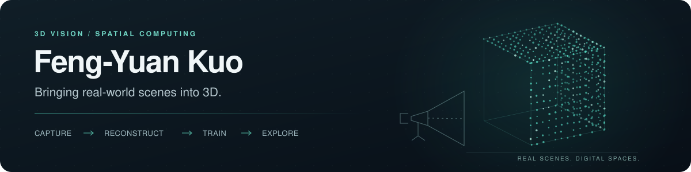

  

  <strong>3D Reconstruction · Gaussian Splatting · On-device AI</strong>

I build tools for capturing, reconstructing, and exploring real-world scenes—from iPhone scanning and on-device Gaussian Splatting training to desktop reconstruction workflows and geospatial visualization.

My projects connect algorithms, data pipelines, and interactive interfaces to make 3D workflows easier to use and inspect.

## What I build

| Area | Practical work |
| :--- | :--- |
| **3D Capture & Reconstruction** | Image and video processing, camera pose refinement, point-cloud workflows, and COLMAP reconstruction. |
| **On-device Gaussian Splatting** | ARKit capture, optional LiDAR fusion, and Swift/Metal training with live previews on iPhone. |
| **Spatial Data & Visualization** | GPS-tagged drone imagery, 3D Tiles conversion, and geographic alignment of Gaussian Splatting scenes. |
| **Local AI Tools** | Document RAG workflows with inspectable retrieval, traceable citations, and reproducible runs. |

## Featured project

### SplatCapture Studio

**Scan, refine, train, and view—all on iPhone.**

Capture scenes with ARKit, review and refine the data, then train a 3D Gaussian Splatting model directly on the device. Export a COLMAP dataset for desktop workflows when needed.

  

  <a href="https://testflight.apple.com/join/hKhVdTUR"><strong>Try on TestFlight ↗</strong></a>
  &nbsp; · &nbsp;
  <a href="https://github.com/KuoFengYuan/arkit-3dgs-scanner">View Source ↗</a>
   
  Free beta · Requires the TestFlight app

  <code>Swift</code> · <code>Metal</code> · <code>ARKit</code> · <code>LiDAR</code> · <code>3DGS</code>

## More projects

| Project | What it does |
| :--- | :--- |
| [Recon Studio](https://github.com/KuoFengYuan/reconstudio) | A local workspace connecting video and photos to COLMAP, 3DGS training, and mesh generation. |
| [3D Tiles Gaussian Splatting Viewer](https://github.com/KuoFengYuan/cesium-gaussian-splat-viewer) | Convert, position, and explore Gaussian Splatting scenes in CesiumJS. |
| [align-capture](https://github.com/KuoFengYuan/align-capture) | Pair drone video frames with MAVLink telemetry and export GPS-tagged imagery for reconstruction. |
| [RAGGlass](https://github.com/KuoFengYuan/RAGGlass) | Inspect PDFs, retrieved evidence, citations, and model answers in a local RAG workbench. |

## Technologies

**3D & Spatial** — Gaussian Splatting, COLMAP, ARKit, Metal, CesiumJS, 3D Tiles

**Development** — Python, Swift, JavaScript, TypeScript, FastAPI, Vue

**Document AI** — Docling, Qdrant, Ollama
